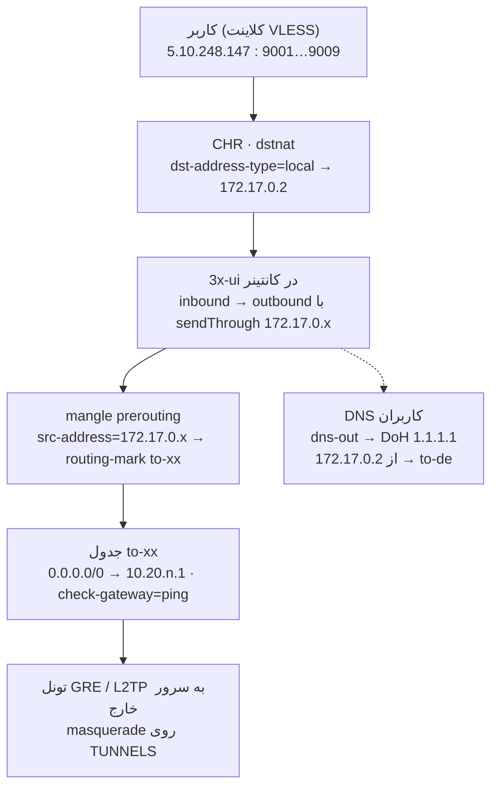

# مستند روتینگ CHR و پنل 3x-ui

<div dir="rtl">

تاریخ: 2026-10-11 · نویسنده: Alireza

## خلاصه

روتینگ کاربران پنل ثنایی (3x-ui) روی CHR اصفهان (5.10.248.147) تمیز و استاندارد شد. هر ۹ مسیر خروجی از تونل خودشان کار می‌کنند و با گوشی هم تست شده‌اند.

- **دامنه کار:** فقط روتینگ کاربرانی که به پنل ثنایی وصل می‌شوند. ساخت تونل‌ها، IP آن‌ها و نصب پنل با اپراتور است. تنظیمات OpenVPN/PPP دست نخورده است.
- **علت اصلی خطای اینستاگرام:** DNS مسموم ایران (جواب 10.10.34.x). با بردن DNS روتر و Xray روی تونل و DoH حل شد.
- **علت خطای speedtest روی 9009:** سرور قربانی پورت‌های مقصد 8080 و 2053 را رد نمی‌کرد. اپراتور آن را باز کرد و مشکل حل شد.
- **پیدا و اصلاح شد:** چند کانفیگ اضافه یا اشتباه روی میکروتیک. مهم‌ترینش dstnat بدون محدودیت مقصد بود که ترافیک کاربران به پورت‌های 2096، 1422 و 9001 تا 9009 هر سایتی را به پنل خودمان منحرف می‌کرد.

## معماری و جریان ترافیک

</div>



<div dir="rtl">

روتر کشور مقصد را از IP مبدأ کانتینر تشخیص می‌دهد: هر outbound در 3x-ui یک `sendThrough` اختصاصی دارد و mangle همان IP را به جدول آن کشور می‌برد.

## کانفیگ نهایی میکروتیک

این بخش حالت فعلی روتر است؛ نسخه کامل در `after-claude.rsc` روی روتر ذخیره شده.

### جدول مسیرها

| پورت | مسیر | IP کانتینر (sendThrough) | outbound | جدول | تونل | Gateway | پشتیبان |
| --- | --- | --- | --- | --- | --- | --- | --- |
| 9001 | آلمان | 172.17.0.3 | out-9001 | to-de | gre-to-DE | 10.20.36.1 | — |
| 9002 | فنلاند | 172.17.0.4 | out-9002 | to-fl | gre-to-FL | 10.20.31.1 | DE |
| 9003 | هلند | 172.17.0.5 | out-9003 | to-hl | gre-to-HL | 10.20.30.1 | DE |
| 9004 | لهستان | 172.17.0.6 | out-9004 | to-pl | l2tp-to-PL | 10.20.32.1 | DE |
| 9005 | ترکیه | 172.17.0.7 | out-9005 | to-trk | gre-to-TRK | 10.20.33.1 | DE |
| 9006 | آمریکا | 172.17.0.8 | out-9006 | to-us | gre-to-USA | 10.20.34.1 | DE |
| 9007 | WARP | 172.17.0.9 | out-9007 | to-warp | gre-to-warp | 10.20.35.1 | — |
| 9009 | فنلاند قربانی | 172.17.0.11 | out-9009 | to-fl-ghorbani | gre-ghorbani-FL | 10.20.37.1 | — |
| — | ترافیک خود 3x-ui (direct، DoH) | 172.17.0.2 | direct | to-de | gre-to-DE | 10.20.36.1 | — |

آدرس 172.17.0.10 آزاد است و برای مسیر بعدی می‌شود از آن استفاده کرد.

### NAT

</div>

```
/ip firewall nat
add chain=srcnat action=masquerade out-interface=ether1 comment="SRCNAT: WAN"
add chain=srcnat action=masquerade out-interface-list=TUNNELS comment="SRCNAT: tunnels"
# port-forward به پنل و inboundها — فقط ترافیکی که مقصدش خود روتر است
add chain=dstnat action=dst-nat protocol=tcp dst-address-type=local dst-port=9001 to-addresses=172.17.0.2 to-ports=9001
# ... همین الگو برای 2096، 1422، 9002 تا 9007 و 9009
```

<div dir="rtl">

### Mangle

</div>

```
/ip firewall mangle
# کاربران PPP (دست نخورده): users-hl/trk/fl/pl/us و Fallback-to-Bypass
# ترافیک خود 3x-ui → آلمان
add chain=prerouting action=mark-connection src-address=172.17.0.2 connection-state=new dst-address-type=!local new-connection-mark=xui-direct passthrough=yes
add chain=prerouting action=mark-routing src-address=172.17.0.2 connection-mark=xui-direct new-routing-mark=to-de passthrough=no
# هر مسیر: یک قانون بر اساس IP مبدأ کانتینر
add chain=prerouting action=mark-routing src-address=172.17.0.11 dst-address-type=!local new-routing-mark=to-fl-ghorbani passthrough=no comment=Finland-Ghorbani
# ... همین الگو برای 0.3 تا 0.9
# MSS
add chain=forward action=change-mss protocol=tcp tcp-flags=syn tcp-mss=1261-65535 dst-address=172.17.0.0/24 new-mss=1260 comment="MSS: clients -> 3x-ui"
add chain=forward action=change-mss protocol=tcp tcp-flags=syn tcp-mss=1281-65535 src-address=172.17.0.0/24 new-mss=1280 comment="MSS: 3x-ui -> tunnels"
```

<div dir="rtl">

### روت‌ها و DNS

- هر جدول `to-*` یک روت پیش‌فرض با `distance=1` و `check-gateway=ping` دارد. پنج جدول یک روت `Backup-to-DE` با `distance=10` هم دارند.
- فهرست `TUNNELS` شامل همه تونل‌های GRE و `l2tp-to-PL` است و در NAT استفاده می‌شود.
- DNS روتر: `servers=8.8.8.8,1.1.1.1` با `use-doh-server=https://8.8.8.8/dns-query`. روت‌های `8.8.8.8/32` و `1.1.1.1/32` در جدول main از تونل آلمان می‌روند (`DNS-via-DE`).
- DNS کانتینر: `8.8.8.8,1.1.1.1`، mount دیتابیس روی `/etc/x-ui`، ساعت تهران.

## تغییرات انجام‌شده

همه تغییرات بعد از گرفتن بکاپ `before-claude` انجام شدند.

| بخش | قبل | بعد | چرا |
| --- | --- | --- | --- |
| dstnat | بدون شرط مقصد | `dst-address-type=local` | ترافیک کاربر به پورت 2096، 1422 یا 9001 تا 9009 هر سایتی به پنل خودمان منحرف می‌شد |
| srcnat | `masquerade` کلی + `masquerade` برای 172.17.0.0/24 | دو قانون: WAN و TUNNELS | masquerade کلی IP واقعی کاربران را از 3x-ui پنهان می‌کرد (IP Limit و Fail2ban بی‌اثر) |
| MSS | ۵ قانون تکراری و یک قانون مخصوص قربانی | دو قانون: 1260 و 1280 | همان مقدار مؤثر قبلی، بدون تکرار |
| روت‌ها | بدون check-gateway | `check-gateway=ping` | بدون آن روت Backup-to-DE هیچ‌وقت فعال نمی‌شد؛ GRE وضعیت ندارد |
| روت‌ها | ۳ روت غیرفعال | حذف | باقیمانده تست‌های قبلی |
| filter | قانون غیرفعال Block-QUIC | حذف | استفاده نمی‌شد |
| dstnat | قانون غیرفعال UDP 9001-9100 | حذف | استفاده نمی‌شد |
| کامنت | پورت 9007 «USA» | «WARP» | با مسیر واقعی یکی شد |
| لیست | — | `TUNNELS` | برای srcnat تونل‌ها |
| کانتینر | mount روی `/xui` و وصل نشده | mount روی `/etc/x-ui`، `TZ=Asia/Tehran`، `ignore-remote-image-change=yes` | دیتابیس پنل با pull دوباره از بین نرود |
| DNS | بدون DoH، از WAN ایران | DoH + روت 8.8.8.8 و 1.1.1.1 از آلمان | جلوگیری از جواب مسموم |
| Xray | DNS سیستمی، قوانین private و bittorrent بی‌اثر | DoH داخلی، `dns-out`، ترتیب درست routing | بخش بررسی پنل |
| تونل قربانی | MTU 1400 | MTU auto (1476) | مسیر پکت 1500 را رد می‌کند |

تنظیمات PPP/OpenVPN (address-listهای `users-*` و `Fallback-to-Bypass`) عمداً دست نخورد.

## مشکلات پیداشده و ریشه‌ها

| علامت | ریشه | اثبات | راه‌حل |
| --- | --- | --- | --- |
| اینستاگرام روی همه مسیرها باز نمی‌شد | DNS مسموم: کوئری‌های 8.8.8.8 از WAN ایران می‌رفت | `:resolve instagram.com` → `10.10.34.36` | روت 8.8.8.8 و 1.1.1.1 از تونل + DoH → `157.240.0.174` |
| speedtest روی 9009 خطا می‌داد | سرور قربانی ترافیک خروجی به پورت 8080 و 2053 را می‌بست؛ همه سرورهای Ookla روی 8080 هستند | portquiz.net: 8080 و 2053 از قربانی ✗، از آلمان ✓؛ ۶ سرور Ookla از قربانی ✗ | اپراتور قربانی روی سرور خودش باز کرد |
| ترافیک کاربر به سایتی روی پورت 2096 جواب غلط می‌گرفت | dstnat بدون شرط مقصد روی CHR | portquiz.net:2096 → 404 از پنل خودمان | `dst-address-type=local` روی همه dstnatها |
| همه کاربران در 3x-ui با آدرس 172.17.0.1 دیده می‌شدند | masquerade بدون out-interface | — | masquerade فقط روی WAN و TUNNELS |
| خطر از دست رفتن کاربران پنل | دیتابیس در `/etc/x-ui` و mount روی مسیر اشتباه + `:latest` با آپدیت خودکار | `mountlists=""` | mount درست + `ignore-remote-image-change=yes` |
| failover کار نمی‌کرد | GRE وضعیت ندارد؛ اینترفیس همیشه running است | بدون check-gateway | `check-gateway=ping` |

درس از این عیب‌یابی: برای مقایسه دو مسیر، از داخل کانتینر با `curl --interface 172.17.0.x` روی **چند پورت مختلف** تست کنید؛ تست فقط روی 443 مشکل پورت 8080 را نشان نمی‌داد.

**مسئله باز: مسیر قربانی (9009).** اینستاگرام IP خروجی قربانی (65.21.149.211) را محدود کرده است. درخواست به `instagram.com` از این IP هر بار با 302 به `accounts/login/?...is_from_rle` (Rate Limit Enforcement) می‌رود؛ از فنلاند و آلمان 200 برمی‌گردد. تونل، MTU و روتینگ سالم‌اند. راه‌حل: IP خروجی جدید برای ترافیک ما روی سرور قربانی (`src-nat` برای 10.20.37.0/30).

## بررسی پنل ثنایی

روتینگ Xray درست است؛ دو مورد در خود inboundها باید اصلاح شود.

| مورد | وضعیت فعلی | توصیه |
| --- | --- | --- |
| نوع inboundها | هر ۸ تا VLESS روی TCP با `security: none` | **مهم:** ترافیک کاربر روی اینترنت ایران رمزنگاری نمی‌شود و DPI آن را تشخیص می‌دهد. به VLESS + Reality تغییر دهید. |
| Sniffing | ۷ inbound خاموش، ۱ روشن | همه روشن با `http`، `tls`، `quic` و Route Only خاموش |
| DNS داخلی Xray | DoH روی 1.1.1.1 و 8.8.8.8، `queryStrategy: UseIPv4` | بماند |
| قانون پورت 53 | همه کوئری‌های DNS کاربران به `dns-out` | بماند؛ DNS کلاینت دیگر مسموم نمی‌شود |
| outboundها | `out-90xx` با `sendThrough` و `domainStrategy: UseIPv4` | بماند؛ `direct` اولین outbound بماند |
| ترتیب routing | api ← dns-out ← private و bittorrent ← قوانین inbound | بماند؛ قبلاً private و bittorrent بعد از قوانین inbound بودند و هیچ‌وقت اجرا نمی‌شدند |
| لاگ | `loglevel: warning`، access خاموش | برای عیب‌یابی موقتاً `access` و `error` را روی `/etc/x-ui/*.log` بگذارید |

پورت 9008 و IP 172.17.0.10 آزاد هستند. پنل روی پورت 2096 است و پورت 1422 هم به کانتینر forward می‌شود.

## نتایج تست

همه ۹ خروجی از داخل کانتینر سالم بودند؛ مسیر 9009 با گوشی هم تایید شد (اینستاگرام و speedtest، بعد از باز شدن 8080 روی سرور قربانی).

| مبدأ | مسیر | IP خروجی | اینستاگرام (HTTPS) | HTTP | دانلود (Mbps) |
| --- | --- | --- | --- | --- | --- |
| 172.17.0.2 | direct → آلمان | 46.4.181.193 | 200 | 200 | 33 |
| 172.17.0.3 | 9001 آلمان | 46.4.181.193 | 200 | 200 | 25 |
| 172.17.0.4 | 9002 فنلاند | 65.108.18.128 | 200 | 200 | 60 |
| 172.17.0.5 | 9003 هلند | (ifconfig.me 403) | 200 | 200 | 74 |
| 172.17.0.6 | 9004 لهستان | 51.77.38.238 | 302 | 200 | 48 |
| 172.17.0.7 | 9005 ترکیه | (ifconfig.me 403) | 200 | 200 | 36 |
| 172.17.0.8 | 9006 آمریکا | 69.197.190.75 | 200 | 200 | 30 |
| 172.17.0.9 | 9007 WARP | 104.28.192.67 | 200 | 200 | 44 |
| 172.17.0.11 | 9009 قربانی | 65.21.149.211 | 200 | 200 | 52 |

تست در 2026-10-11 ساعت 23:15 انجام شد. دستور آن (داخل `/container shell 0`):

</div>

```
for i in 2 3 4 5 6 7 8 9 11; do a=172.17.0.$i; echo "$a ip=$(curl --interface $a -m 8 -s https://ifconfig.me) ig=$(curl --interface $a -m 8 -s -o /dev/null -w '%{http_code}' https://www.instagram.com) http=$(curl --interface $a -m 8 -s -o /dev/null -w '%{http_code}' http://example.com) dl=$(curl --interface $a -m 15 -s -o /dev/null -w '%{speed_download}' 'https://speed.cloudflare.com/__down?bytes=10000000')"; done
```

<div dir="rtl">

تست پورت‌ها روی یک مسیر (برای پیدا کردن پورت بسته روی سرور مقابل):

</div>

```
for p in 80 443 5222 8080 8443 2053; do echo "$p $(curl --interface 172.17.0.11 -m 6 -s -o /dev/null -w '%{http_code}' http://portquiz.net:$p/)"; done
```

<div dir="rtl">

## راه‌اندازی مسیر جدید

اپراتور تونل را می‌سازد؛ روتینگ آن چهار قدم روی میکروتیک و سه قدم در پنل است. دستورهای آماده در فایل [`chr-3xui-setup.md`](chr-3xui-setup.md) هستند.

**الزامات اپراتور (قبل از روتینگ):**

- یک /30 مستقل (الگو: `10.20.<n>.0/30`، سمت ایران `.2`، سمت خارج `.1`) روی اینترفیس تونل.
- سمت خارج masquerade برای همان /30 و جواب به ping روی `.1`.
- هیچ DNAT یا REDIRECTی روی سرور خارج بدون شرط مقصد نباشد (مشکل 8080 قربانی).
- MTU تونل حداقل 1400.

**روتینگ (با مثال مسیر انگلیس، پورت 9010، IP آزاد 172.17.0.10):**

1. جدول و روت: `/routing table add name=to-uk fib` و `/ip route add routing-table=to-uk gateway=10.20.38.1 check-gateway=ping`.
2. اینترفیس تونل را به لیست `TUNNELS` اضافه کنید.
3. IP آزاد را به `veth1` اضافه کنید (کانتینر باید stop و start شود).
4. mangle (`src-address=172.17.0.10` → `to-uk`) و dstnat پورت 9010 با `dst-address-type=local`.
5. در پنل: inbound پورت 9010 (Sniffing روشن)، outbound freedom با `sendThrough: 172.17.0.10`، قانون routing از inbound به این outbound.
6. تست با `curl --interface 172.17.0.10` از داخل کانتینر.

## عیب‌یابی سریع و بکاپ

| علامت | اولین چک |
| --- | --- |
| سایت‌های فیلتر روی همه مسیرها باز نمی‌شوند | `:put [:resolve instagram.com]` — اگر 10.10.34.x بود، روت DNS-via-DE را چک کنید و `/ip dns cache flush` |
| فقط یک مسیر مشکل دارد | همان IP کانتینر را با `curl --interface` روی چند پورت (portquiz.net) کنار یک مسیر سالم تست کنید |
| مسیر به آلمان رفته است | `/ip route print where routing-table=to-xx` — روت اصلی inactive یعنی ping به `.1` جواب نمی‌دهد |
| پنل از بیرون باز نمی‌شود | `/ip firewall nat print where dst-port=2096` و `/container print` |
| لاگ Xray لازم است | در Advanced موقتاً `access` و `error` را روی `/etc/x-ui/*.log` بگذارید |

**بکاپ‌ها روی روتر (Files):**

- `before-claude.backup` و `before-claude.rsc` — حالت قبل از تغییرات.
- `after-claude.backup` و `after-claude.rsc` — حالت فعلی.

برگشت کامل: `/system backup load name=before-claude.backup` (روتر ریبوت می‌شود). یک کپی از فایل‌های بکاپ را بیرون از روتر نگه دارید.

</div>
